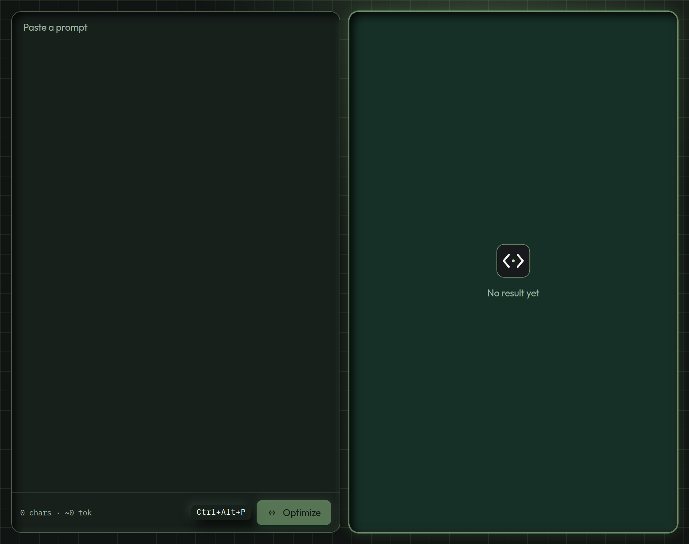
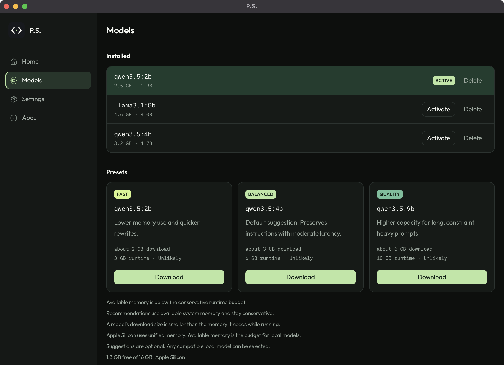

# P.S.

P.S. is a local prompt optimizer for people who write prompts to coding agents.

It lives in the macOS menu bar or the Windows system tray. Select a prompt, press a shortcut, and a model running in [Ollama](https://ollama.com/download) rewrites it only when a clearer version would help the next agent. An already effective prompt stays exactly as you wrote it. If a decision only you can make is missing, P.S. asks one question. You still send the prompt yourself.

The rule is a **minimum sufficient prompt**: keep what changes the work, add only what helps it get done, and remove the rest. A better prompt is not a longer one. P.S. does not promise that the next agent will use fewer tokens.



**Version 0.1.0.** The menu-bar and tray application is in this repository, on top of the optimizer in [`crates/ps-core`](crates/ps-core). [Run it from source](#install) on Apple Silicon macOS or Windows 11.

## Contents

- [Use it](#use-it)
- [Requirements](#requirements)
- [Install](#install)
- [Set up](#set-up)
- [Privacy](#privacy)
- [Repository](#repository)
- [Forks](#forks)
- [License](#license)

## Use it

1. Select the prompt in Cursor, VS Code, a browser field, or another editor.
2. Press the shortcut.
3. Read the result, then submit it yourself.

| | macOS | Windows |
| --- | --- | --- |
| Improve | Control+Option+P | Ctrl+Alt+P |
| Compact | Control+Option+Shift+P | Ctrl+Alt+Shift+P |

Improve makes the request easier to carry out. Compact removes filler and keeps every requirement. Either shortcut can be changed or turned off in Settings.

Closing the window hides P.S. Quit from the menu bar or the tray.

### Three results

**Rewritten.** A checked improvement replaces the selection when the same window still has the same text. If focus moved, the selection changed, or the rewrite dropped something that mattered, P.S. opens a review instead of pasting.

**Unchanged.** The original text stays put. A small “Already clear” note is the whole result.

**Needs a decision.** P.S. shows one question in its own window. The question is not typed into your editor.

A vague bug report can become an instruction to investigate, fix, and check the result. A sentence that is already specific should survive untouched:

> Add a loading spinner to the Submit button while the existing request is in progress.

That is the behaviour P.S. is built for. It is not a promise that every model will phrase the rewrite the same way.

## Requirements

| | |
| --- | --- |
| Desktop app | macOS 14 Sonoma or newer on Apple Silicon, or Windows 11 x64 |
| This repository | Rust 1.90. With [rustup](https://rustup.rs), `rust-toolchain.toml` selects the compiler, rustfmt, and clippy. Linux is a supported host for building and testing the core. |
| Models | [Ollama](https://ollama.com/download) on the same computer |

Intel Macs and Windows 10 are outside the desktop target.

## Install

Clone the repository and start the desktop app:

```bash
git clone https://github.com/omer-chandna/P.S.git
cd P.S
npm install
npm run tauri dev
```

You need Node.js 22 and Rust 1.90. On a Mac, install the Xcode command line tools. On Windows 11, install the Visual Studio C++ build tools and the WebView2 runtime. The first launch is the setup guide. Closing the window hides P.S. Quit from the menu bar or the tray.

The core tests stand in for Ollama with a local mock. They leave installed models alone, and the Ollama daemon can stay stopped.

```bash
cargo test -p ps-core
npm test
```

To check a checkout:

```bash
cargo fmt --all --check
cargo clippy -p ps-core --all-targets -- -D warnings
cargo test -p ps-core
npm run lint
npm run typecheck
npm test
```

Unsigned installers, from a Mac or a Windows machine:

```bash
npm run tauri build -- --bundles dmg --target aarch64-apple-darwin
npm run tauri build -- --bundles nsis --target x86_64-pc-windows-msvc
```

## Set up

Install [Ollama](https://ollama.com/download) and leave it running on this computer. The first launch of the desktop app walks through the connection, a model, and the shortcut. The core already applies the same limits.

The only accepted addresses are loopback. The default is `http://127.0.0.1:11434`. `localhost` and `::1` are accepted. A public host, a path, or a username in the URL is rejected.



The suggestions are starting points, not a ranking. Download size is the registry file. The runtime budget is a conservative reserve used to phrase the suggestion, and it is larger than the download.

| | Model | Download | Runtime budget | Aimed at |
| --- | --- | --- | --- | --- |
| Fast | `qwen3.5:2b` | about 2 GB | 3 GB | Less memory, quicker rewrites |
| Balanced | `qwen3.5:4b` | about 3 GB | 6 GB | The usual recommendation |
| Quality | `qwen3.5:9b` | about 6 GB | 10 GB | Long prompts with many constraints |

Any compatible local model can be selected. Cloud entries stay visible in the list and are refused for inference. That includes a remote host on the model, and a name that carries a cloud tag.

Sampling defaults live with the engine: temperature 0.2, top-p 0.9, a 90 second timeout, and reasoning off unless you turn it on. The full contract is in the [prompt engine](docs/PROMPT_ENGINE.md) notes.

## Privacy

Inference stays on your machine. There is no account and no subscription. Selected prompts are not saved and are not written to logs. Starting a model download is the one action that contacts Ollama’s model registry.

## Repository

| Path | Role |
| --- | --- |
| [`crates/ps-core`](crates/ps-core) | Endpoint checks, the Ollama client, optimization, preservation, shortcuts, and settings. The window, global hotkeys, and clipboard I/O stay outside this crate, so a later CLI can share the rules. |
| [`src-tauri/`](src-tauri) | Menu bar, tray, global shortcuts, capture, and paste. |
| [`src/`](src) | The window: home, models, settings, onboarding. |
| [`prompts/`](prompts/README.md) | System instructions, version 1.0.0. The selected prompt is a separate user message. |
| [`fixtures/prompts.json`](fixtures/prompts.json) | Representative cases. Tests replay mocked model output against them. |
| [`docs/PROMPT_ENGINE.md`](docs/PROMPT_ENGINE.md) | What counts as a better prompt, and what the model is told. |
| [`docs/RELEASING.md`](docs/RELEASING.md) | Installers, signing, and notarization. |

Signing and notarization are not set up. The build produces unsigned installers.

## Forks

P.S. is open source so you can keep your own copy. Fork the repository, change it, and build from that fork. The [MIT license](#license) covers that copy, including one you maintain and ship yourself.

Write access to this repository stays with the maintainer. Other people cannot push to it. A change is considered here only as a pull request, and it is merged when the maintainer approves it. Opening one is optional.

A pull request that gets merged keeps these boundaries:

- The Ollama address stays on loopback.
- Each optimization is one chat request. The model classifies and rewrites in that same call.
- Prompt text stays out of logs and off disk.
- The shipped app is Apple Silicon macOS and Windows 11. Linux builds and tests the core.
- The packaged binary name is `postscript`, so it stays clear of the Unix `ps` process tool.

Branch from `main` and note what you ran, including the checks under [Install](#install). When a report quotes a real prompt, use a stand-in sentence if the original contains private code.

## License

P.S. is released under the [MIT License](LICENSE).

Copyright (c) 2026 P.S. contributors.

You may use, copy, modify, merge, publish, distribute, and sell this project, including in commercial work. Keep the copyright notice and the license text with the software. The project is provided as is, without warranty.
